<div align="center">


# Grimorio

**Tu hoja de personaje y libro de conjuros de Dungeons & Dragons, en el móvil o en el ordenador.**

Reglas del Manual del Jugador de 2024 · Sin cuentas · Funciona sin conexión

[](https://github.com/AdrianJimenezSantiago/DnD-Grimoire/releases/latest)
[](https://github.com/AdrianJimenezSantiago/DnD-Grimoire/releases/latest)
[](https://github.com/AdrianJimenezSantiago/DnD-Grimoire/releases/latest)
[](https://dnd-grimoire-five.vercel.app)
[](https://github.com/AdrianJimenezSantiago/DnD-Grimoire/actions/workflows/pruebas.yml)

### [⬇️ Descargar la última versión](https://github.com/AdrianJimenezSantiago/DnD-Grimoire/releases/latest) · [🌐 Usar en el navegador](https://dnd-grimoire-five.vercel.app)

<br>

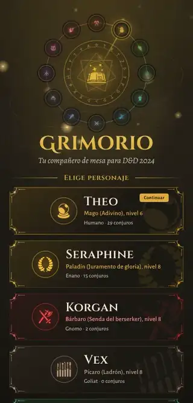
&nbsp;&nbsp;&nbsp;
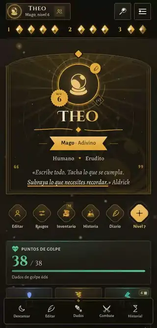

<sub>Abrir la hoja, lanzar un conjuro, entrar en combate · Tirar dados con su distribución</sub>

</div>

---

## 📖 ¿Qué es?

Grimorio sustituye a la hoja de papel. Creas a tu personaje y la app **hace las cuentas por ti**: clase de armadura, bonificadores, CD de conjuros, espacios, recursos de clase, carga… Durante la partida lanzas conjuros con un toque, apuntas el daño, gastas usos y descansas; la app recupera lo que toca en cada descanso.

No hace falta saberse las reglas de memoria ni tener cuenta en ningún sitio. **Todo se guarda en tu propio dispositivo.**

## 🖼️ Así se ve

<table>
  <tr>
    <td align="center" width="33%">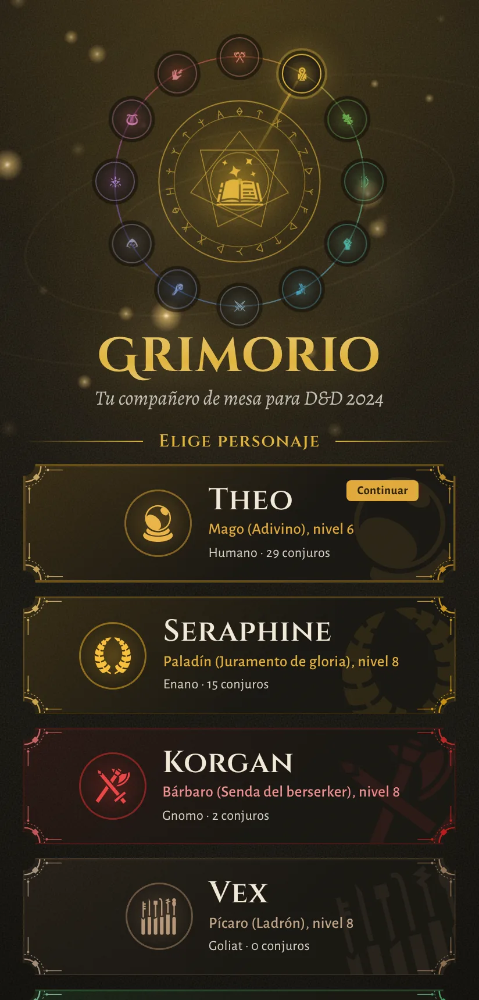<br><b>Tus personajes</b><br><sub>Cada uno con el color y el emblema de su clase</sub></td>
    <td align="center" width="33%">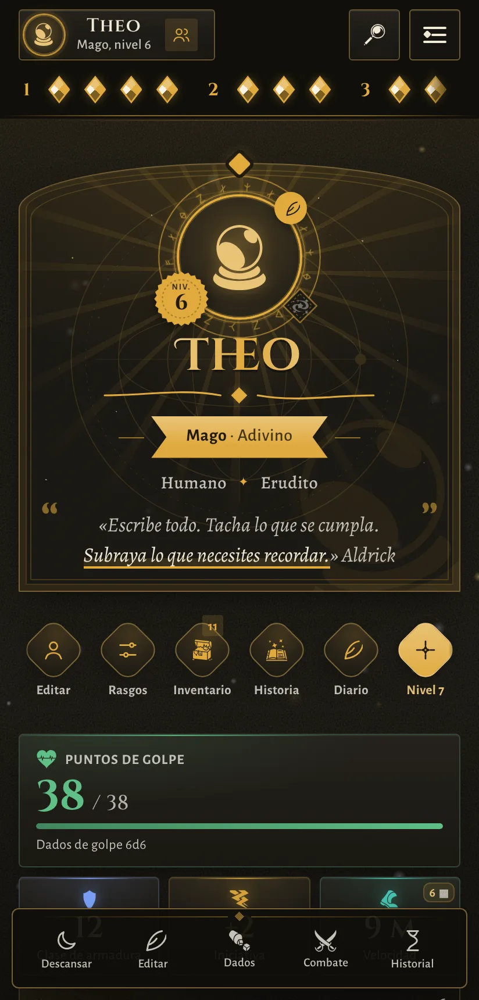<br><b>La hoja</b><br><sub>Vida, CA, espacios y rasgos a la vista</sub></td>
    <td align="center" width="33%">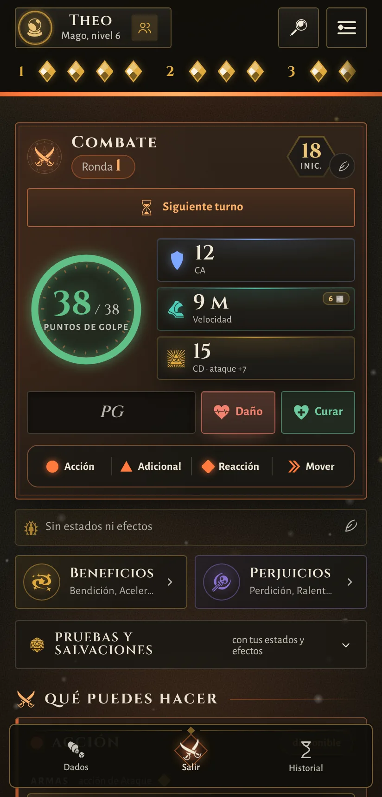<br><b>Modo combate</b><br><sub>Ronda, iniciativa y qué te queda del turno</sub></td>
  </tr>
  <tr>
    <td align="center">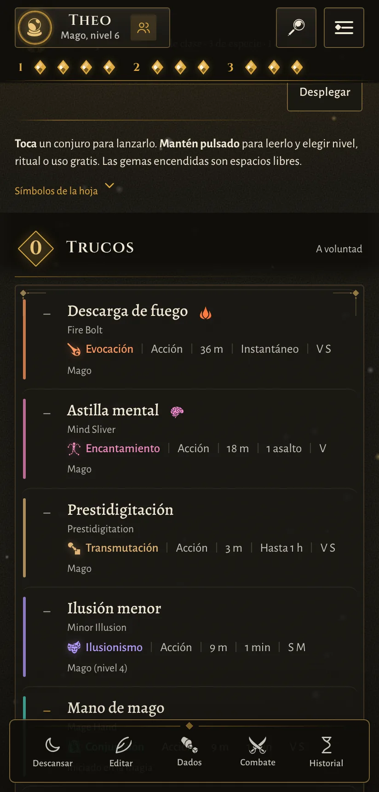<br><b>Libro de conjuros</b><br><sub>Toca para lanzar, mantén pulsado para leer</sub></td>
    <td align="center">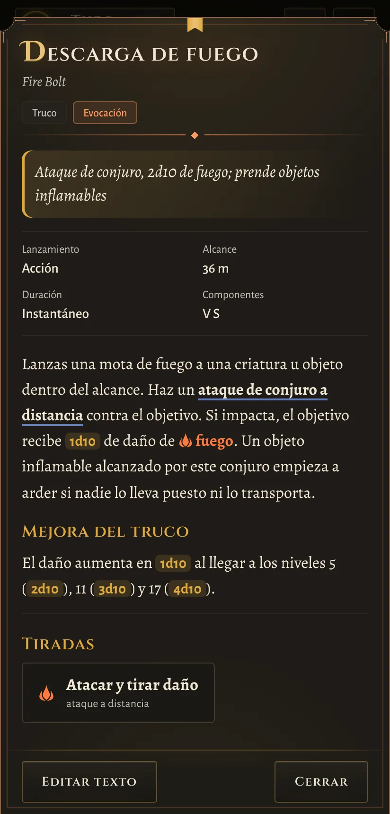<br><b>Cada conjuro</b><br><sub>Dados, salvaciones y daño resaltados</sub></td>
    <td align="center">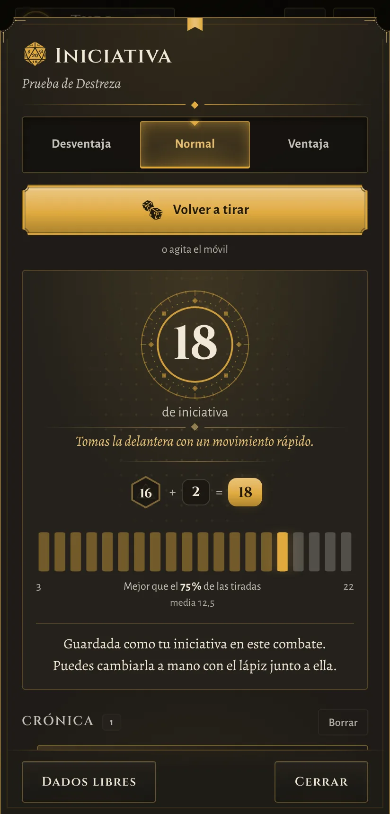<br><b>Tiradas con historia</b><br><sub>Cada resultado con su frase y su probabilidad</sub></td>
  </tr>
  <tr>
    <td align="center">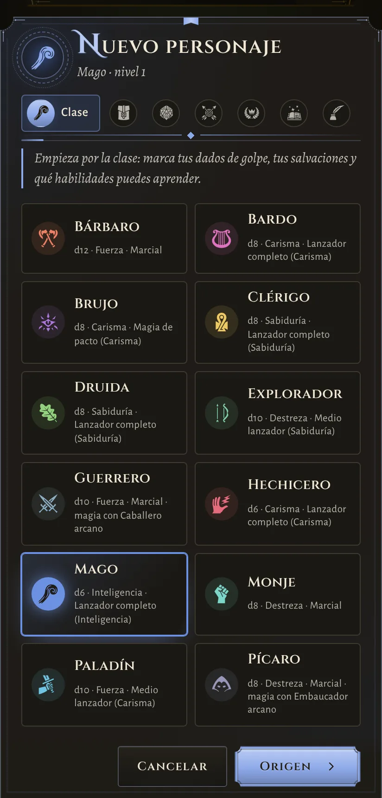<br><b>Creación guiada</b><br><sub>Clase, origen, características y dotes</sub></td>
    <td align="center">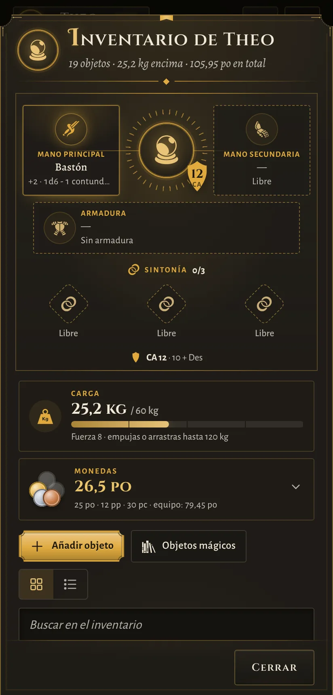<br><b>Inventario</b><br><sub>Manos, armadura, sintonía, carga y monedas</sub></td>
    <td align="center">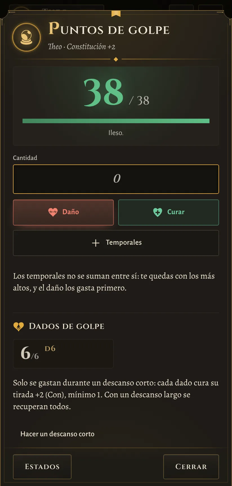<br><b>Vida</b><br><sub>Daño, curación, temporales y dados de golpe</sub></td>
  </tr>
</table>

<details>
<summary><b>💻 En el ordenador, de noche y de día</b></summary>
<br>

| Noche | Día |
|:---:|:---:|
| 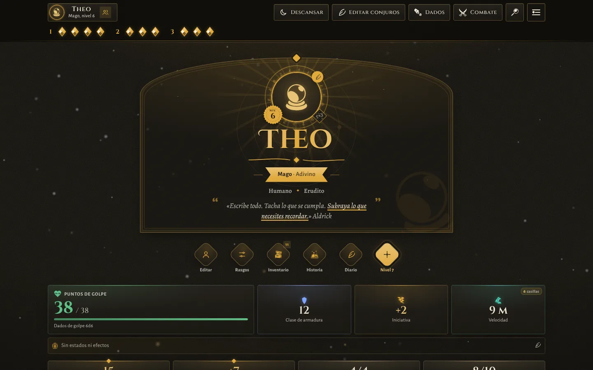 | 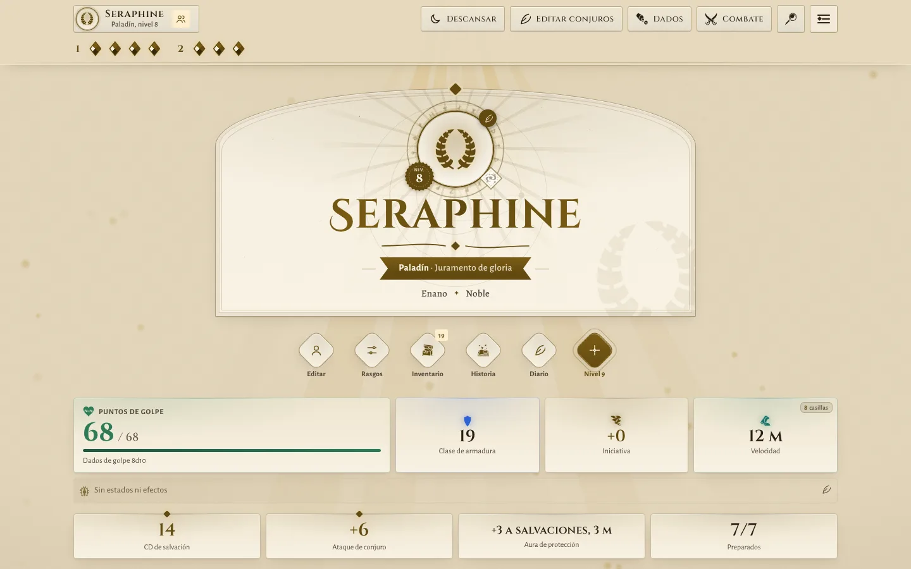 |

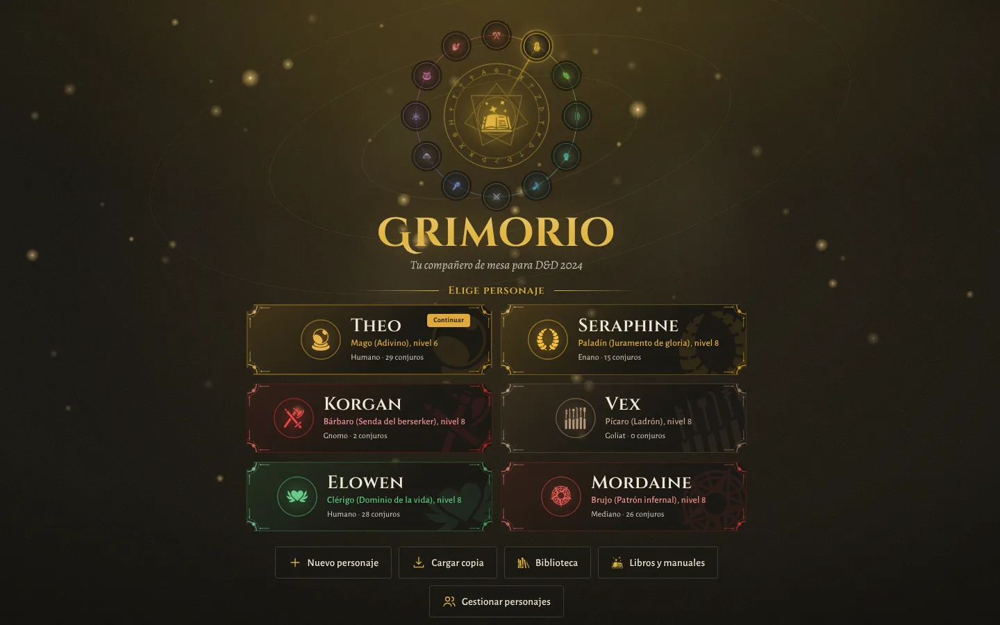
</details>

## ✨ Qué puedes hacer

| | |
|---|---|
| 🧙 **Crear tu personaje paso a paso** | Clase, subclase, especie, trasfondo, características y dotes, con ayuda en cada paso. Todas las clases y subclases de 2024, del nivel 1 al 20, y multiclase. |
| ⬆️ **Subir de nivel sin líos** | Un asistente te dice qué ganas en cada nivel y qué tienes que elegir. |
| ❤️ **Llevar la vida y el estado** | Daño, curación, puntos temporales, dados de golpe, salvaciones contra muerte, estados y agotamiento. |
| ✨ **Lanzar conjuros** | Libro de conjuros con filtros, rituales y concentración. Toca para lanzar, mantén pulsado para leer. |
| ⚔️ **Modo combate** | Una pantalla solo para la pelea: iniciativa, ronda, qué te queda del turno y tus ataques, conjuros y rasgos ordenados por acción. |
| 🎲 **Tirar dados** | Para cualquier tirada, con ventaja y desventaja. Las pruebas y salvaciones se tiran tocándolas. |
| 🎒 **Inventario** | Equipo en las manos y puesto, mochila, monedas con cambio, munición, pociones y objetos mágicos con sintonización. |
| 📜 **Diario y bestiario** | Apunta lo que pasa en cada sesión y lo que sabéis de cada criatura. |
| 📚 **Tus libros dentro** | Si tienes el PDF del Manual del Jugador u otro libro, impórtalo y verás las descripciones completas. Se lee en tu dispositivo y no sale de él. |
| 👥 **Varios personajes** | Cada uno con el color y el emblema de su clase. Puedes pasárselos a otro dispositivo o al DJ. |

## ⬇️ Cómo instalarla

Elige la opción que mejor te venga. Todas son gratuitas.

<details open>
<summary><b>📱 En Android (recomendado)</b></summary>

1. Desde el móvil, abre **[la última versión](https://github.com/AdrianJimenezSantiago/DnD-Grimoire/releases/latest)**.
2. Baja hasta el apartado **Assets** y toca el archivo que empieza por **`grimorio-`** y termina en **`.apk`**.
3. Cuando termine la descarga, ábrelo. Si el móvil pide permiso para *instalar apps desconocidas*, acéptalo.
4. Si aparece un aviso de **Play Protect**, toca **Más detalles → Instalar de todos modos**. Sale porque la app no viene de la Play Store; es normal.

> [!TIP]
> **Para actualizar**, repite los mismos pasos con la versión nueva. Se instala encima y **tus personajes se conservan**.
</details>

<details>
<summary><b>🌐 En el navegador (iPhone, iPad o cualquier dispositivo)</b></summary>

Abre **<https://dnd-grimoire-five.vercel.app>** y listo.

- En **iPhone/iPad** (Safari): botón *Compartir* → **Añadir a pantalla de inicio**, y la tendrás como una app más.
- En **Android** (Chrome): menú ⋮ → **Añadir a pantalla de inicio**.

Los personajes se guardan en ese navegador, en ese dispositivo.
</details>

<details>
<summary><b>💻 En Windows (sin conexión)</b></summary>

1. Abre **[la última versión](https://github.com/AdrianJimenezSantiago/DnD-Grimoire/releases/latest)** y descarga el archivo **`grimorio-windows-….html`**.
2. Guárdalo en una carpeta fija (por ejemplo, *Documentos*).
3. Ábrelo con doble clic. Mejor con **Edge** o **Chrome**.

> [!IMPORTANT]
> **Para actualizar**, sustituye el archivo por el nuevo **con el mismo nombre y en la misma carpeta**, para no perder tus datos.
</details>

## 🚀 Primeros pasos

1. En la portada, toca **Nuevo personaje** (o toca una clase de la rueda) y sigue los pasos.
2. Añade tus conjuros desde **Editar conjuros → Añadir**.
3. En la mesa, **toca** un conjuro para lanzarlo y **mantén pulsado** para leerlo o elegir a qué nivel lanzarlo.
4. Si tienes los libros en PDF, impórtalos desde **Más → Libros**.
5. De vez en cuando, haz una **copia de seguridad** desde **Más → Copia de seguridad**.

¿Perdido? La app trae un tutorial que puedes repetir cuando quieras desde **Más → Ver tutorial**.

## ❓ Preguntas frecuentes

<details>
<summary><b>¿Puedo perder a mi personaje?</b></summary>

Los datos viven solo en tu dispositivo. Si borras la app, los datos del navegador o cambias de móvil, se pierden **salvo que tengas una copia de seguridad**. Hazla de vez en cuando desde **Más → Copia de seguridad** y guarda el archivo en un sitio seguro (Drive, correo, WhatsApp…).
</details>

<details>
<summary><b>¿Cómo paso mi personaje del móvil al ordenador (o a otro móvil)?</b></summary>

Haz una copia de seguridad en el dispositivo de origen, envíate el archivo y restáurala en el otro desde **Más → Copia de seguridad**. También puedes exportar un solo personaje para mandárselo al DJ.
</details>

<details>
<summary><b>¿Necesito Internet?</b></summary>

No. La versión de Android y la de Windows funcionan sin conexión. La versión web solo necesita conexión la primera vez; después también abre sin ella.
</details>

<details>
<summary><b>El móvil dice que la app puede ser peligrosa. ¿Es normal?</b></summary>

Sí. Android avisa siempre que instalas algo que no viene de la Play Store. La app no pide permisos especiales ni envía tus datos a ningún sitio.
</details>

<details>
<summary><b>¿Por qué algunos conjuros o rasgos no tienen la descripción completa?</b></summary>

La app incluye de serie el contenido libre de las reglas (SRD). Las descripciones del resto de libros aparecen si importas tus propios PDF desde **Más → Libros**.
</details>

<details>
<summary><b>He encontrado un fallo o tengo una idea. ¿Qué hago?</b></summary>

Díselo al DJ, o si tienes cuenta de GitHub, [abre una incidencia](https://github.com/AdrianJimenezSantiago/DnD-Grimoire/issues/new/choose): hay un formulario sencillo para fallos y otro para ideas.
</details>

## 🛠️ Para desarrolladores

<details>
<summary>Ver detalles técnicos</summary>

Aplicación web en JavaScript (Vite) empaquetada para Android con Capacitor. Hace falta **Node 22**.

```bash
npm install
npm run dev            # la app en local, con recarga
npm test               # pruebas de reglas y estado (node --test)
npm run lint           # revisión del código con ESLint
npm run build          # web en www/
npm run build:windows  # versión de Windows en un solo HTML
```

**Estructura**

```text
web/src/
├── domain/      reglas del juego, funciones puras: reglas, clases, origen, personaje,
│                combate, conjuros, equipo, criaturas, libros, presentacion
├── app/         casos de uso que unen reglas e interfaz (lanzar, descansar, importar)
├── ui/          pantallas, dialogs, selectores, componentes y animaciones
├── core/        estado, guardado y utilidades
├── platform/    Android (Capacitor), almacenamiento y lectura de PDF
└── styles/      un CSS por área y tokens.css
web/public/data/ compendio de conjuros del SRD y vocabulario del OCR
tests/           pruebas con la misma estructura que web/src/domain, más integracion/
tools/           auditorias/, compendio/, iconos/, ocr/, capturas y publicación
docs/            arquitectura, auditorías y capturas (docs/img)
android/         proyecto Android de Capacitor
```

La guía de [arquitectura](docs/arquitectura.md) explica las capas, qué puede depender de qué, los patrones del código y dónde va cada cosa nueva. En [docs/](docs/README.md) están también las auditorías de reglas, interfaz, rendimiento y seguridad.

**Ramas y versiones**

- `main`: versión estable. Cada cambio compila el APK y la versión de Windows y los publica en [Releases](https://github.com/AdrianJimenezSantiago/DnD-Grimoire/releases), con versionado semántico (`MAYOR.MENOR.PARCHE`):
  - cada pull request fusionado sube el parche (2.3.0 → 2.3.1);
  - `[menor]` en el título del pull request sube la versión menor (2.3.4 → 2.4.0), para funciones nuevas;
  - `[mayor]` sube la mayor (2.4.1 → 3.0.0), para cambios grandes.
- `development`: trabajo en curso. Cada cambio pasa las pruebas automáticamente.

</details>

## 📜 Créditos

Incluye material del System Reference Document 5.2 («SRD 5.2») de Wizards of the Coast LLC, con licencia [CC BY 4.0](https://creativecommons.org/licenses/by/4.0/legalcode). Las descripciones de los libros solo aparecen si importas tus propios PDF. Fuentes Alegreya, Alegreya Sans, Cinzel y Cinzel Decorative con licencia SIL Open Font License 1.1. Iconos de [game-icons.net](https://game-icons.net) con licencia CC BY 3.0.

Proyecto de aficionado, sin relación con Wizards of the Coast. *Dungeons & Dragons* es una marca de Wizards of the Coast.

<div align="center">

Hecho con 🎲 por [Adrián Jiménez Santiago](https://github.com/AdrianJimenezSantiago)

</div>
