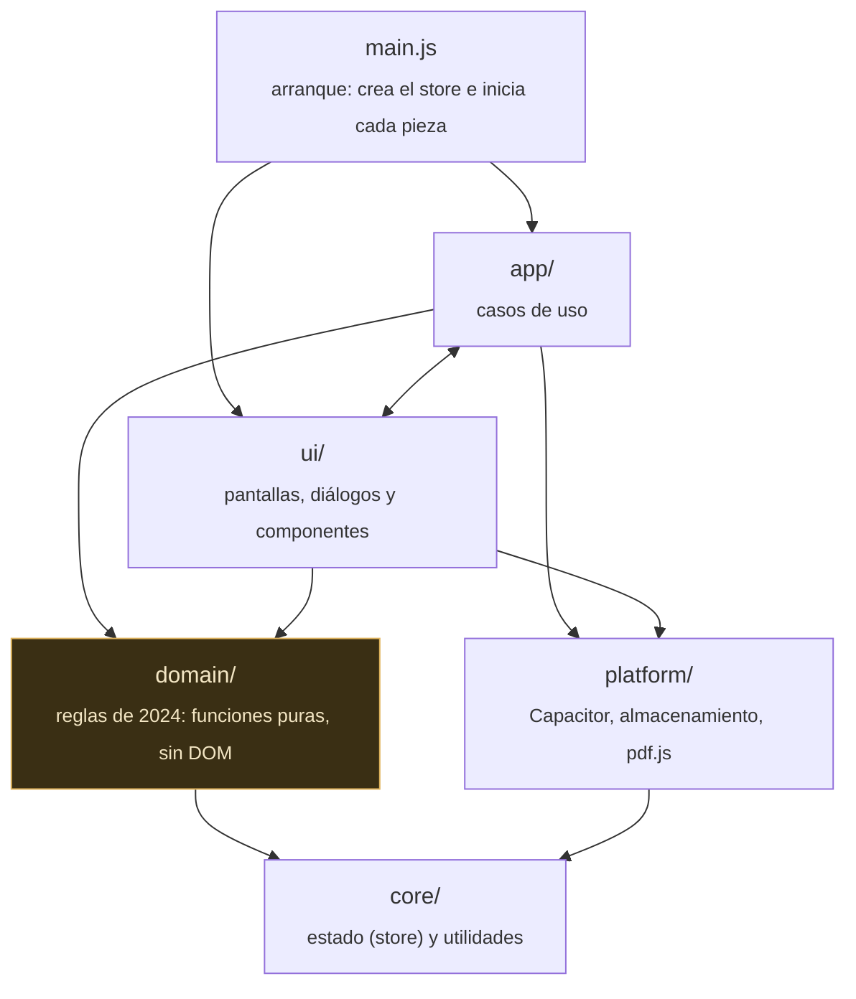

# Arquitectura

Guía para orientarse en el código de Grimorio: cómo está organizado, qué puede depender de qué y dónde va cada cosa nueva. Cada archivo de `web/src` empieza con una línea que dice qué contiene; este documento da el mapa de conjunto.

> [!TIP]
> Si vas con prisa: las reglas están en `domain/` y se prueban sin navegador; la interfaz solo las llama. `tests/arquitectura/capas.test.js` avisa si algo cae en la capa equivocada.

## Capas



| Capa | Qué hay | Puede importar |
|---|---|---|
| `core/` | El store (estado, guardado, deshacer), utilidades de texto y números, carga perezosa de módulos | Nada de la app |
| `domain/` | Todas las reglas del juego y el modelo de datos. Funciones que reciben un personaje (`ch`) y calculan algo o lo modifican | `domain/`, `core/` |
| `platform/` | Lo que depende del dispositivo: Capacitor en Android, almacenamiento, compartir archivos, pdf.js | Paquetes de npm, `core/` |
| `app/` | Casos de uso que combinan reglas, estado y avisos: `acciones.js` (lanzar, gastar, descansar), `combate.js` (iniciativa, rondas, ataques), `edicionConjuros.js`, `importarManual.js`. `eventos.js` conecta la hoja con todo lo demás | Todo |
| `ui/` | HTML de pantallas y diálogos, componentes y animaciones | `domain/`, `core/`, `platform/`; de `app/` solo `acciones.js` (y `importarManual.js` con carga perezosa) |

`tests/arquitectura/capas.test.js` comprueba las reglas principales: `core/` no importa nada, `domain/` solo usa `domain/` y `core/`, y solo `platform/` importa Capacitor o pdf.js. Si esa prueba falla, la lógica nueva está en la capa equivocada.

## Mapa de carpetas

### `web/src/domain/` — reglas del juego

| Carpeta | Contenido | Módulo de entrada |
|---|---|---|
| `reglas/` | Núcleo de las reglas de 2024: características, competencia, niveles, multiclase, habilidades, salvaciones, dados y resúmenes de reglas | `reglas2024.js` (`perfil(ch)`: CD, ataque, espacios, preparados) |
| `clases/` | Clases y subclases, rasgos y recursos, subida de nivel, opciones y variantes de rasgo, estilos, maniobras, «En juego» | `clases2024.js`, `rasgos.js` |
| `origen/` | Especies, trasfondos, dotes de origen y conjuros que dan las dotes | `especies.js`, `origen.js` |
| `personaje/` | Modelo de datos y normalización, creación de personaje, diario, historia, personajes de prueba | `modelo.js` |
| `combate/` | Vida y muerte, efectos y estados, concentración, combate por rondas, ataques al impactar, maestrías, áreas | `vida.js`, `efectos.js`, `combate.js` |
| `conjuros/` | Catálogo y compendio, espacios de conjuro, análisis de tiradas de cada conjuro, validación | `catalogo.js`, `espacios.js` |
| `equipo/` | Inventario, armas y armaduras, monedas y carga, objetos mágicos (efectos, variantes, acciones, consumibles) | `equipo.js` |
| `criaturas/` | Bestiario de la campaña, perfiles para invocar o transformarse y lector de perfiles de los libros | `bestiario.js` |
| `libros/` | Importación de PDF (corrección del OCR, columnas, tablas y un lector por tipo de contenido) y lo ya importado: libros cargados y glosario | `libroCompleto.js` (`analizarLibro`), `biblioteca.js` (`fijarLibros`), `terminos.js` |
| `presentacion/` | Lógica pura de presentación que se prueba sin navegador: búsqueda, realce de texto, frases de las tiradas, paleta de colores, validación de lo que se escribe a mano, geometría del teclado en pantalla, calidad de los efectos según el dispositivo | — |

### `web/src/ui/` — interfaz

| Carpeta | Contenido |
|---|---|
| `componentes/` | Piezas base reutilizables: DOM (`$`, `on`, `patch`, `morph`), apertura de diálogos, modales, avisos (`toast`), iconos, tema por clase, tutorial, teclado en pantalla (`teclado.js`: ningún campo queda debajo del teclado) |
| `pantallas/` | Lo que está siempre en pantalla: portada (`portada`), hoja (`hoja`, `vitales`), modo combate, fichas de lectura rápida y pantalla de luto |
| `dialogs/` | Un módulo por diálogo de la app (conjuro, inventario, vida, dados, biblioteca, subir de nivel…) |
| `selectores/` | Piezas de elección que usan varios diálogos: subclase, especie, dote, habilidades, maestrías, maniobras, «al impactar» |
| `animaciones/` | Efectos visuales: fondo animado (con su Worker), chispas, runas, golpes, impactos y dados que ruedan |

### Resto del repositorio

| Ruta | Contenido |
|---|---|
| `web/index.html` | Estructura de la página, con un `<dialog id="…">` por cada diálogo |
| `web/src/styles/` | Un CSS por área (`sheet.css`, `dialogs.css`, `inventario.css`…) y `tokens.css` con los colores y medidas |
| `web/public/data/` | Compendio de conjuros del SRD y vocabulario para corregir el OCR |
| `tests/` | Pruebas automáticas (ver más abajo) |
| `tools/auditorias/` | Scripts que generan las auditorías de `docs/` (clases, conjuros, origen, objetos) y las de accesibilidad y contraste |
| `tools/compendio/` | Compendio de conjuros del SRD (`npm run srd`): datos de Open5e, nombres y traducciones |
| `tools/iconos/` | Icono de la app y pantallas de carga (`npm run icons`) y los iconos de game-icons.net |
| `tools/ocr/` | Medición y corrección del OCR de los manuales ([README](../tools/ocr/README.md)) |
| `tools/*.mjs` | Publicación (`siguiente-version`, `preparar-libros`, `renombrar-windows`) y capturas de `docs/img` (`capturas`) |
| `android/` | Proyecto Android de Capacitor |

## Patrones

### Reglas (`domain/`)

- Las funciones reciben el personaje (`ch`) y **devuelven un valor** (`perfil(ch)`, `caEfectiva(ch)`) o **lo modifican en el sitio** (`aplicarDano(ch, n)`, `anadirObjeto(ch, o)`). No guardan, no avisan y no tocan el DOM: eso lo hacen `app/` y `ui/`.
- Los datos del Manual (clases, especies, objetos con efecto…) son constantes en mayúsculas (`CLASES_INFO`, `RASGOS_ESPECIE`, `OBJETOS_EFECTO`) junto a las funciones que los usan.
- Los textos de los libros solo se leen si el usuario los importa; sin ellos, la app usa resúmenes propios (`reglas/referencia.js`, `conjuros/tiradasBase.js`).

### Estado (`core/store.js`)

Hay un único store, `S`, que se pasa a cada pieza al arrancar.

```js
const h = S.act('Lanza Bola de fuego', (db, ch) => { ch.play.used[3]++; }); // acción de juego: va al historial y se puede deshacer
S.edit((db, ch) => { ch.nombre = 'Theo'; });                                // edición de la hoja
toast('Hecho.', [botonDeshacer(S, h)]);                                       // aviso con «Deshacer»
```

Cada cambio emite un evento; `main.js` vuelve a pintar la hoja y cada diálogo abierto se repinta con `S.subscribe`.

### Guardado y datos del usuario

- **Personajes**: `S.flush()` escribe toda la base de datos con `almacen.guardar` (localStorage en la web y Windows, `Preferences` en Android) 200 ms después del último cambio y al salir. Si falla (almacenamiento lleno o bloqueado) no se calla: `crearEstado({ alFallar, alRecuperar })` avisa, el cambio queda pendiente y se reintenta con el siguiente.
- **Archivos grandes** (libros importados, retratos originales, copias automáticas, deshacer guardado): `archivos` de `platform/native.js`. En Android van a `Filesystem`; en la web y Windows, a IndexedDB (`platform/archivosWeb.js`), que pasa solo lo que hubiera en localStorage con el prefijo `file:` de versiones anteriores y vuelve a localStorage si IndexedDB no se puede abrir.
- **Copias automáticas**: una al día en el dispositivo, las 5 últimas (`domain/personaje/copias.js` decide cuándo y cuáles se borran; `ui/dialogs/copia.js` las guarda y las restaura).
- **Deshacer tras reiniciar**: `S.historialGuardable()` da las 10 últimas acciones con su personaje de antes, y `S.recuperarHistorial()` las vuelve a cargar al arrancar.
- **Esquema**: `ESQUEMA` en `domain/personaje/modelo.js`. Si cambia la forma de los datos guardados, se sube `ESQUEMA` y se añade `MIGRACIONES[n]` (del esquema `n` al `n + 1`) con su prueba; `migrarBd` las encadena al cargar y al abrir una copia. Los datos de una versión más nueva se cargan como se puede, guardando antes el original intacto.

### Diálogos (`ui/dialogs/`)

Todos siguen la misma forma:

```js
let S;                                       // el store, guardado en init
export function abrirHistorial() { render(); abrirDialogo($('#histDlg')); }
export function init(store) {                // main.js lo llama una vez al arrancar
  S = store;
  S.subscribe(() => { if ($('#histDlg').open) render(); });
  on($('#histBody'), 'click', '[data-hundo]', …);
}
```

El `<dialog>` está en `web/index.html`; el módulo lo rellena con HTML generado (`render`) y escucha sus eventos con delegación (`on`). Los botones de la hoja llevan `data-cmd="…"`, y `app/eventos.js` (`COMMANDS`) decide qué abre cada uno.

Para pintar, `patch(el, html)` cambia todo el contenido si el HTML es distinto. Lo que se repinta mientras el usuario interactúa (la hoja, el modo combate, los diálogos de tiradas, vida, estados, beneficios, inventario y creación) usa `morph(el, html)`: compara con el DOM que ya hay y solo toca lo que cambia, así lo que sigue igual no repite su animación de entrada ni pierde el hover o el foco. Dos reglas al escribir HTML que se pinta con `morph`:

- Los bloques que aparecen o desaparecen según el estado (una franja de «activos», un aviso de concentración) llevan `data-key`, para que los demás no se emparejen por posición con el bloque equivocado.
- Un botón solo se reutiliza si sus `data-*` son iguales; si cambian, se crea uno nuevo. Así un clic que repinta a mitad del evento nunca convierte el botón pulsado en otro.

### Carga perezosa

Los módulos pesados que no hacen falta al abrir la app (asistentes de personaje y de nivel, importación de PDF) se cargan con `import()` a través de `app/asistentes.js` o `core/cargar.js`.

### Nombres

- Archivos y funciones nuevas en castellano y en `camelCase` (`aplicarDano`, `libroCompleto.js`); constantes de datos en `MAYUSCULAS`.
- Los verbos de las funciones también en castellano y siempre los mismos: `abrir…` para diálogos, `pintar…` para HTML, `fijar…` para guardar un estado del módulo, `leer…` para los lectores de libros, `norm…` para normalizar datos guardados.
- Siguen en inglés, a propósito: los métodos del store (`S.act`, `S.edit`, `S.undo`…), las ayudas del DOM (`$`, `on`, `patch`, `morph`), `toast` y los **campos de los datos guardados** (`ch.book`, `play.used`, `level`…). Cambiar esos campos obligaría a migrar los personajes guardados en cada dispositivo.
- Un archivo de `ui/` puede llamarse igual que uno de `domain/` cuando es su interfaz (`domain/combate/alImpactar.js` y `ui/selectores/alImpactar.js`).

### Comentarios

Cada archivo lleva **una línea de cabecera** que dice qué contiene, y nada más: el código se explica con nombres claros y con sus pruebas. Lo que hace falta saber de una regla del manual (de qué rasgo sale, a qué nivel, por qué se aplica así) va en el título de su prueba y en las auditorías de `docs/`, no en comentarios que se quedan viejos. Las únicas excepciones son las directivas que leen las herramientas (`/* global … */` para ESLint).

## Pruebas

```bash
npm test                                   # todas
npm run test:cobertura                     # las mismas, con la cobertura de domain/ y core/ y sus mínimos
npm run e2e                                # compila la web y la recorre en Chromium (e2e/)
npm run lint                               # ESLint: variables sin declarar e imports sin usar
node --test tests/combate/vida.test.js     # un archivo
node --test --test-name-pattern="muerte" "tests/**/*.test.js"   # las que contienen una palabra
```

| Carpeta | Qué prueba |
|---|---|
| `tests/<área>/<módulo>.test.js` | Un módulo de `web/src/domain/<área>/`. `tests/combate/vida.test.js` prueba `domain/combate/vida.js` |
| `tests/core/` | El store y las utilidades |
| `tests/presentacion/` | Búsqueda, realce, frases, paleta, validación, teclado y calidad de efectos |
| `tests/ui/` | Lógica pura de la interfaz que se puede probar sin navegador |
| `tests/seguridad/` | Lo que llega de fuera (copias y personajes importados) y la configuración segura de la web y la APK |
| `tests/tools/` | Los scripts de publicación (la versión de cada release) |
| `tests/integracion/` | Pruebas que cruzan varios módulos: auditorías contra el Manual, todas las combinaciones de clase y especie, un combate simulado |
| `tests/arquitectura/` | Las reglas de dependencia entre capas y que todo lo importado exista |
| `tests/platform/` | La parte de `platform/` que no depende del dispositivo (archivos en IndexedDB con paso desde localStorage) |
| `tests/helpers/fixtures.js` | Utilidades comunes: leer el compendio, copiar un arma predefinida, leer un archivo del repositorio |
| `e2e/*.e2e.js` | La app compilada en Chromium con `playwright-core`: guardado y copias, hoja (atajos, deshacer, imprimir, vista de grupo), combate y compartir. `e2e/entorno.js` sirve `www/` y siembra los personajes |

Las pruebas de extremo a extremo buscan la versión de Chromium de `playwright-core`; si no la tienes, `npx playwright-core install chromium` (o `CHROMIUM=/ruta/a/chrome npm run e2e`). La CI de los pull requests pasa las tres: unitarias con cobertura mínima, extremo a extremo y lint.

Dentro de cada archivo, cada `describe` agrupa las pruebas de una función o de una regla (`describe('salvaciones contra muerte', …)`), y el título de cada `test` dice qué comportamiento comprueba. Los personajes de ejemplo se crean con `normPersonaje(personajeVacio({ … }))` en un auxiliar al principio del archivo.

## Cómo añadir…

**Una regla nueva** (un rasgo, una dote, un efecto): va en el módulo de `domain/` del área que toca, con su prueba en el archivo espejo de `tests/`. Si la hoja tiene que mostrarla, la pantalla o el diálogo la llama; la regla no sabe nada de la interfaz.

**Un diálogo nuevo**: añade el `<dialog id="…">` en `web/index.html`, crea `ui/dialogs/<nombre>.js` con `init(store)` y `open…()`, llama a su `init` en `main.js` y, si se abre desde un botón con `data-cmd`, añade la orden en `COMMANDS` de `app/eventos.js`. Sus estilos van en el CSS del área (o en `dialogs.css`).

**Un lector para otro tipo de contenido de los libros**: un módulo nuevo en `domain/libros/` que recibe líneas ya corregidas y devuelve objetos; se llama desde `libroCompleto.js`. Las pruebas usan páginas de juguete hechas con auxiliares como `L(x, y, texto)`.

**Una dependencia del dispositivo** (un plugin de Capacitor, una API del navegador): solo en `platform/`, con una alternativa para la web y Windows.
